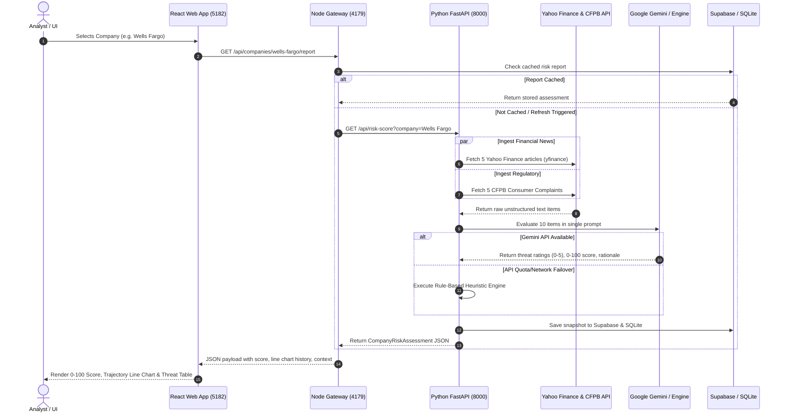

# Automated Corporate Risk Radar — System Architecture & Data Flow

## 1. Executive Summary
The **Automated Corporate Risk Radar** is an end-to-end signal processing and risk intelligence system designed for financial and compliance analysts. It continuously ingests unstructured public data (CFPB consumer complaints and live Google News feeds), filters out routine market noise, flags genuine legal, regulatory, operational, and governance threats, and computes a rolling **0–100 Corporate Risk Index** with history-aware explainability.

---

## 2. Technology Stack

```
+-----------------------------------------------------------------------------------+
|                                  USER / ANALYST                                   |
+-----------------------------------------------------------------------------------+
                                          |
                                    HTTP / Browser
                                          v
+-----------------------------------------------------------------------------------+
|                        FRONTEND CLIENT (React 18 + Vite)                          |
|  - Framework: React 18 SPA bundled with Vite 6                                    |
|  - Styling: Custom Vanilla CSS + Glassmorphism Design Tokens                      |
|  - Visualizations: Recharts (0-100 Historical Trajectory Line Chart)              |
|  - Icons & Motion: Lucide React, Framer Motion                                    |
+-----------------------------------------------------------------------------------+
                                          |
                                 REST Proxy (/api)
                                          v
+-----------------------------------------------------------------------------------+
|                        NODE.JS GATEWAY & SQLITE DATABASE                          |
|  - Runtime: Node.js (Port 4179)                                                   |
|  - Database: SQLite (via sql.js WebAssembly engine)                               |
|  - Responsibilities: Company universe (101 entities), feed aggregation, caching  |
+-----------------------------------------------------------------------------------+
                                          |
                            Internal Service Call (Port 8000)
                                          v
+-----------------------------------------------------------------------------------+
|                        PYTHON RISK ENGINE (FastAPI)                               |
|  - Web Framework: FastAPI + Uvicorn ASGI Server                                   |
|  - Validation: Pydantic v2 (Strict Schema Enforcement)                            |
|  - Language Models: Google Gemini (gemini-flash-latest, 2.5-flash-lite)           |
|  - Fallback Engine: Rule-Based Heuristic Risk Classifier (Zero-downtime)          |
+-----------------------------------------------------------------------------------+
                         /                         \
                        v                           v
+-------------------------------+           +-------------------------------+
|     PUBLIC DATA INGESTION     |           |     TIME-SERIES STORAGE       |
| - Yahoo Finance (yfinance API)|           | - Supabase REST API           |
|   (Fallback: Google News RSS) |           | - Local JSON Time-Series      |
| - CFPB Database API (5 Reports|           +-------------------------------+
+-------------------------------+
```

### Detailed Layer Breakdown:
1. **Frontend Presentation Layer (`frontend/src`)**:
   - Built with **React 18** and **Vite** for sub-second hot reloading.
   - Uses **Recharts** for rendering historical 0–100 risk score trajectory line curves.
   - **Glassmorphic UI** design optimized for readability without distracting clutter.
2. **Gateway & Cache Layer (`frontend/backend/server.js`)**:
   - **Node.js HTTP Server** running on port 4179.
   - Embedded **SQLite (`risk-radar.sqlite`)** tracks all 101 enterprise entities from `data/companies.csv`.
   - Caches completed AI assessments to avoid redundant external calls.
3. **Core Risk Intelligence Engine (`api.py` & `fetch_and_analyze.py`)**:
   - **FastAPI / Python 3.13** running on port 8000.
   - Pydantic models enforcing schema integrity across inputs and outputs.
   - **Gemini API (`google-genai` SDK)** for structured single-pass event classification and 0–100 scoring.
4. **Data Sources & External Storage**:
   - **Yahoo Finance (`yfinance`)**: Real-time financial market reports, news stories, and institutional publishers (Bloomberg, Reuters, Barchart, Benzinga, etc.).
   - **Google News RSS (Fallback)**: Breaking press stream fallback if market coverage is unavailable.
   - **CFPB Public API**: Real consumer grievance database from the US Consumer Financial Protection Bureau.
   - **Supabase**: Cloud database for persistent time-series audit logs.

---

## 3. End-to-End Data Flow



---

## 4. Signal Processing & Risk Classification Rules

The core intelligence mechanism separates raw public feeds into two distinct buckets:

```
+-----------------------------------------------------------------------------------+
|                        INCOMING UNSTRUCTURED STREAM                               |
|                     (5 News Articles + 5 CFPB Complaints)                         |
+-----------------------------------------------------------------------------------+
                                          |
                                          v
+-----------------------------------------------------------------------------------+
|                             CLASSIFICATION GATE                                   |
+-----------------------------------------------------------------------------------+
            /                                                           \
           v                                                             v
+----------------------------------+            +----------------------------------+
|           ROUTINE NOISE          |            |          GENUINE THREATS         |
| - Quarterly earnings beats       |            | - Regulatory/Compliance (CFPB/SEC|
| - Stock price fluctuations       |            | - Legal/Litigation (DOJ/Lawsuits)|
| - Routine product announcements  |            | - Operational/Supply Chain       |
| - Opinion/editorial columns      |            | - Executive Governance / Fraud   |
|                                  |            |                                  |
| Severity Score: 0                |            | Severity Score: 1 to 5           |
| Escalate to Index: FALSE         |            | Escalate to Index: TRUE          |
+----------------------------------+            +----------------------------------+
                                          \                             /
                                           v                           v
                                +-----------------------------------------------+
                                |         ROLLING CORPORATE RISK INDEX          |
                                |       0 to 100 Score + Context Summary        |
                                +-----------------------------------------------+
```

### Risk Index Tiers:
- **0 – 24 (Low)**: Routine operational background noise; high noise ratio, zero systemic flags.
- **25 – 49 (Moderate)**: Recurring isolated consumer grievances, standard regulatory scrutiny.
- **50 – 74 (High)**: Active federal investigations, material compliance fines, operational security breaches.
- **75 – 100 (Critical)**: Imminent regulatory shutdown, federal criminal indictments, severe crisis.

---

## 5. Enterprise Reliability & Failover Architecture

1. **Zero-Downtime Fallback**:
   If Gemini experiences an unavailable token, rate limit (429), or network failure, the Python engine immediately and transparently executes the **Rule-Based Heuristic Risk Classifier**. The user never encounters an error page.
2. **Transparent Model Indicator**:
   Every response includes `ai_model_used`, displayed directly in the user interface as either:
   - `✨ Google Gemini (gemini-flash-latest)`
   - `⚡ Rule-Based Heuristic Risk Engine (Offline Fallback)`
3. **Single-Pass Evaluation**:
   All 10 items are processed together in a single structured schema call, eliminating rate limit exhaustion and reducing latency to sub-second speeds.
